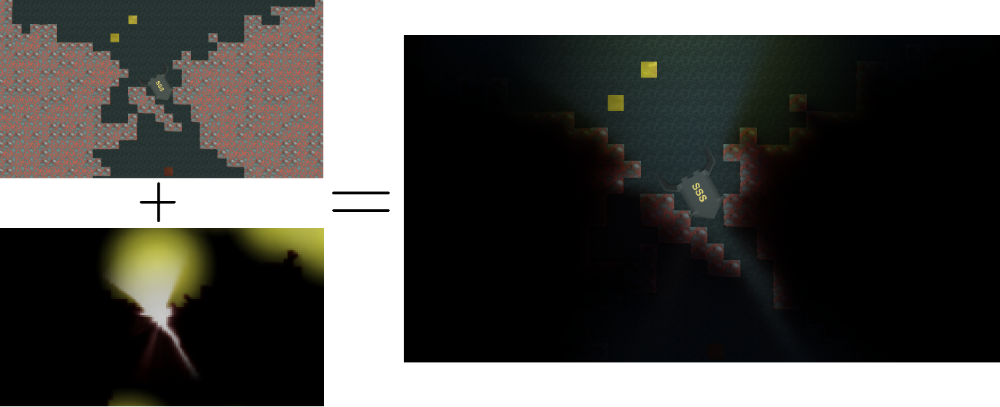

# Components and Architecture

## Frame Model

Light2D separates lighting inputs from normal scene rendering with three layers. Each frame it:

1. Renders obstacle opacity and color into an extended, low-resolution texture.
2. Renders direct light sprites against the obstacle texture.
3. Renders ambient emitters and advances a persistent ambient-propagation history.
4. Optionally blurs direct and ambient textures.
5. Composites the lighting textures over the source camera color.

The extended texture covers more world space than the source view so lights and obstacles just outside the screen can contribute. The small texture covers the visible camera area. Light-camera positions are snapped to the lighting pixel grid to reduce shimmer while the camera moves.

## Pipeline Boundaries

### Built-in

`LightingSystem.OnRenderImage` owns the frame. It configures and explicitly renders the serialized helper camera, allocates `RenderTexture` instances through `LightingRenderResources`, and performs the final `Graphics.Blit` composition. `AffectOnlyThisCamera` temporarily redirects the source camera through an additional target.

### URP

`Light2DUniversalRendererFeature` owns rendering. Its RenderGraph pass derives culling and view/projection matrices from the source camera, performs renderer-list draws, imports ambient history, and replaces camera color. It does not use the Built-in helper `LightCamera`. Contexts and history are keyed by `LightingSystem`, so multiple source cameras do not share ambient state. The feature is attached to renderer data, but enqueues only when the currently rendered camera itself has an enabled `LightingSystem`.

Universal Renderer Data and 2D Renderer Data integration is implemented. Current development-host evidence does not behaviorally verify either path because URP validation is blocked by the editor/package import defect described in [TESTING.md](TESTING.md#current-urp-validation-blocker).

Do not route Built-in work through the renderer feature or URP work through `OnRenderImage`. `LightingSystem.IsScriptableRenderPipelineActive` prevents the Built-in backend from running under an SRP.

`LightingSystem.ActivePipeline` classifies the active pipeline as `Light2DPipeline.BuiltIn`, `Light2DPipeline.UniversalRenderPipeline`, or `Light2DPipeline.UnsupportedScriptableRenderPipeline`. `IsRenderingReady` reports false under an unsupported SRP, and enabling a `LightingSystem` there logs one actionable warning. XR cameras, URP Overlay cameras, and URP Base cameras with an active Overlay stack are rejected by the renderer feature with one warning per camera; independent Base cameras, including split screen, are supported.

## Runtime Components

### `LightingSystem`

Attach one to each source camera that needs Light2D. Important groups are:

- Coverage and resolution: `LightPixelSize`, `LightCameraSizeAdd`, `LightCameraFovAdd`, `LightObstaclesDistance`.
- Features: `EnableAmbientLight`, `BlurLightSources`, `BlurAmbientLight`, `HDR`, `LightObstaclesAntialiasing`, `EnableNormalMapping`, `AffectOnlyThisCamera`, `XZPlane`.
- Inputs: the three layer indices and serialized compute, overlay, and blur materials.
- Backend state: `LightCamera` for Built-in only; URP uses `SourceCamera` and the renderer feature.

Runtime rendering clones serialized materials. Change the source material assets for defaults or adjust the clones indirectly through `LightingSystem` inputs; do not depend on runtime writes mutating the asset.

### `LightSprite`

`LightSprite` derives from `CustomSprite` and generates a four-vertex mesh. It writes point or line origin data into UV1 for the light shader. The sprite and transform define coverage, while `LightOrigin.z` is the light height used by normal mapping.

Use the ray-marching materials named `Light2D/Light 20 Points` through `Light2D/Light 90 Points` to trade GPU work for shadow sampling. `Light2D/Light Auto Points` chooses a variable count and is the most expensive option. `Light2D/Light 1 Point` does minimal obstacle sampling; `Light2D/Light Ignoring Obstacles` skips obstacles and is suitable for effects such as particles.

### Obstacles

`LightObstacleSprite` mirrors a parent `SpriteRenderer` or `CustomSprite`. `LightObstacleMesh` mirrors a parent mesh and texture into a runtime-generated mesh/material. `LightObstacleGenerator` chooses one at play start and then destroys itself.

`MultiplicativeColor` is stored in vertex color. `AdditiveColor` is packed into UV1 for dual-color obstacle shaders. Obstacles do not require colliders.

### `CustomSprite`

`CustomSprite` builds a quad from a Unity `Sprite`, uses `MeshFilter` and `MeshRenderer`, and reference-counts generated material instances by source material, texture, and UV mode. Generated meshes and materials use `DontSave`; they are runtime/editor working objects, not assets to edit.

## Quality Settings

| Setting | Effect and tradeoff |
| --- | --- |
| Light Pixel Size | World units per lighting pixel. Lower values increase texture dimensions, precision, memory, and GPU cost. |
| Light Texture Height | Inspector view of the derived height. Editing it adjusts Light Pixel Size. Recommended starting ranges are 50-200 mobile and 200-1000 desktop. |
| Light Camera Size Add | Orthographic world-space margin for off-screen contributors. Increase if lights clip near corners. |
| Light Camera Fov Add | Perspective field-of-view margin for off-screen contributors. |
| Camera To Light Obstacles Distance | Perspective depth plane used to derive texture coverage. Obstacles should share that effective depth. |
| 64 Bit Color | Uses half-float lighting textures when supported; otherwise falls back to 8-bit RGBA. In URP, camera and asset HDR settings also matter. |
| Light Obstacles Antialiasing | Renders obstacles at twice each dimension, then resolves them. This is roughly four times the obstacle texture pixel count. |
| Texture Filtering | `Point` preserves pixelated lighting; bilinear smooths upscaling. |
| Blur Light Sources | Adds a source blur pass. With normal mapping it can noticeably reduce normal detail. |
| Enable Ambient Light | Enables temporal ambient propagation and its persistent history textures. Disable it when unused. |
| Blur Ambient Light | Adds a blur after each ambient propagation cycle. |
| Normal Mapping | Renders full-camera normals and processes visible lights individually. It is substantially more expensive. |

Profile representative scenes on the target GPU. Historical device timings and fixed draw-call counts from pre-2.0 releases are not reliable guidance for Unity 6000.4 or URP RenderGraph.

## Material and Shader Contract

Serialized scenes and materials depend on shader names and property names. Preserve these contracts when changing shaders:

- Direct-light shaders use `_MainTex`, `_ObstacleMul`, and `_EmissionColorMul`; auto-points also uses `_StepCountMul`.
- Overlay shaders use `_GameTex`, `_AmbientLightTex`, `_LightSourcesTex`, `_LightSourcesMul`, `_LightMul`, `_AdditiveLightPow`, and `_AdditiveLightAdd`.
- Ambient propagation uses `_MainTex`, `_ObstacleMul`, `_ObstacleAdd`, `_EmissionColorMul`, and `_SamplingDist`.
- Normal-aware obstacle shaders use `_MainTex`, `_NormalTex`, and the `LightObstacle=True` SubShader tag.
- Runtime backends set global textures and vectors including `_ObstacleTex`, `_NormalsBuffer`, `_PixelsPerBlock`, `_ExtendedToSmallTextureScale`, and `_PosOffset`.
- URP-compatible object passes use `SRPDefaultUnlit`, `UniversalForward`, or `UniversalForwardOnly`; package shaders retain Built-in CG passes after their URP subshaders.

The misspelled shader name `Light2D/Obstacle Texture Post Porcessor` is a compatibility identifier and must not be corrected without a material and lookup migration.

## Normal Mapping

Use `Light2D/Transparent Normal Mapped` or `Light2D/Transparent Dual Color Normal Mapped`, assigning base and normal textures. Custom shaders must expose `_MainTex` and `_NormalTex` and include the `LightObstacle=True` SubShader tag to participate in replacement rendering.

Normal mapping is restricted to orthographic XY rendering in both backends by the current shared shader contract. Normal textures should not be packed into an atlas if their UV layout no longer matches the base sprite.
