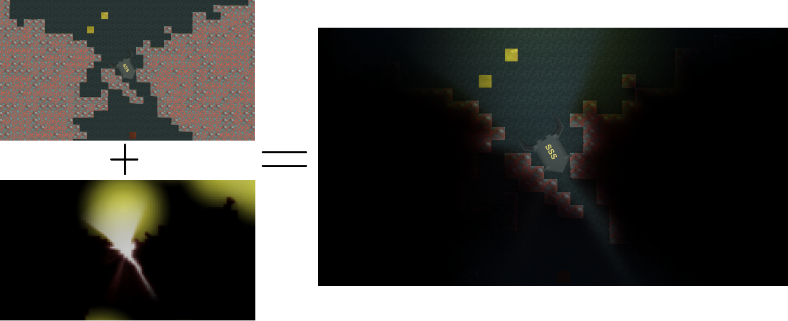

# Components and Architecture

## Frame Model

Light2D separates lighting inputs from normal scene rendering by *role*, not by
layer. Three roles — light sources, ambient emitters, and obstacles — are expressed
as self-registering components (see [Runtime Components](#runtime-components)). Each
frame it:

1. Renders obstacle opacity and color into an extended, low-resolution texture.
2. Renders direct light sprites against the obstacle texture.
3. Renders ambient emitters and advances a persistent ambient-propagation history.
4. Optionally blurs direct and ambient textures.
5. Composites the lighting textures over the source camera color.
6. When coverage volumes are present, or `LightingSystem.DefaultCoverage` is below 1, blends that composite back toward the raw camera color through a coverage mask (see [Coverage Volumes](#coverage-volumes)).

The extended texture covers more world space than the source view so lights and obstacles just outside the screen can contribute. The small texture covers the visible camera area. Sampling positions are snapped to the lighting pixel grid to reduce shimmer while the camera moves.



## Register-and-Draw Core

Light2D uses a register-and-draw model rather than layers or a helper camera. A
component that participates in lighting registers itself with an internal registry
(`Light2DRenderRegistry`) in `OnEnable` and deregisters in `OnDisable`. During the
frame, `LightingSystem` (Built-in) and `Light2DUniversalRendererFeature` (URP) take
a snapshot of the registered components for each role and draw them into the
role's `RenderTexture` with `CommandBuffer.DrawMesh` (`Light2DDraw`). No source
camera, culling mask, or child camera is involved.

No input component owns a scene renderer at all. Each builds a bare mesh plus a
generated material and hands the render core a draw-entry snapshot; the geometry is
drawn only through the registry with `CommandBuffer.DrawMesh`, so lighting-input
geometry never appears in the game image. Light sources and obstacles carry neither
a `MeshRenderer` nor a `MeshFilter`; the ambient emitter and `LightObstacleMesh`
keep a `MeshFilter` only as an optional self-mesh *input*. This invariant replaces
the old requirement to exclude Light2D layers from the source camera culling mask —
there are no layers to exclude, there is no renderer to disable, and inputs cannot
leak into the composited frame.

Built-in composition materials (overlay, ambient compute, blur) are supplied by an
internal `Light2DDefaultResources` ScriptableObject that the creation window assigns
to a new `LightingSystem`. There is no `Lighting Camera` prefab and no
`LightingSystemPrefabConfig`.

## Pipeline Boundaries

### Built-in

`LightingSystem.OnRenderImage` owns the frame. It allocates `RenderTexture` instances through `LightingRenderResources`, draws the registered role components into them with command buffers (register-and-draw; there is no helper camera), and performs the final `Graphics.Blit` composition. `AffectOnlyThisCamera` temporarily redirects the source camera through an additional target.

### URP

`Light2DUniversalRendererFeature` owns rendering. Its RenderGraph pass derives culling and view/projection matrices from the source camera, draws the registered role components, imports ambient history, and replaces camera color. Contexts and history are keyed by `LightingSystem`, so multiple source cameras do not share ambient state. The feature is attached to renderer data, but enqueues only when the currently rendered camera itself has an enabled `LightingSystem`.

Universal Renderer Data and 2D Renderer Data integration is implemented, and both are behaviorally verified by the package's URP PlayMode suite.

Do not route Built-in work through the renderer feature or URP work through `OnRenderImage`. `LightingSystem.IsScriptableRenderPipelineActive` prevents the Built-in backend from running under an SRP.

`LightingSystem.ActivePipeline` classifies the active pipeline as `Light2DPipeline.BuiltIn`, `Light2DPipeline.UniversalRenderPipeline`, or `Light2DPipeline.UnsupportedScriptableRenderPipeline`. `IsRenderingReady` reports false under an unsupported SRP, and enabling a `LightingSystem` there logs one actionable warning. XR cameras, URP Overlay cameras, and URP Base cameras with an active Overlay stack are rejected by the renderer feature with one warning per camera; independent Base cameras, including split screen, are supported.

## Coverage Volumes

By default Light2D composites its lighting over the whole camera image. *Coverage
volumes* scope that composition to regions. The final pixel is

```
final = lerp(rawGameImage, light2dComposite, coverage)
```

where `coverage` is read from a per-frame *coverage mask*. Coverage `1` shows the
Light2D composite (the lit-and-shadowed result); coverage `0` lets the raw game
image pass through untouched (Light2D is bypassed there); intermediate values
cross-fade between the two.

Both backends implement coverage as an additive stage after the existing overlay
composition, with no change to the frozen overlay shaders: the volumes rasterize
their shapes into the coverage mask, the overlay writes into an intermediate
composite target, and one final blit blends the raw color and the composite by the
mask. The Built-in path is behaviorally verified; the URP path is a structural
mirror of it.

### DefaultCoverage baseline

`LightingSystem.DefaultCoverage` (range `0`–`1`, default `1`) clears the coverage
mask before any volume draws — it is the world-wide baseline:

- `DefaultCoverage = 1` (default): lighting everywhere. `lerp(raw, composite, 1)` is
  exactly the composite, identical to the pre-volume behavior. When no volumes exist
  and the baseline is 1, the entire coverage stage is skipped and **no coverage
  textures are allocated** — the render is byte-identical to before and costs
  nothing. This is what keeps the feature backward compatible.
- `DefaultCoverage = 0`: the world shows the raw game image at full brightness, and
  Light2D applies only where a volume paints coverage back up. This is the
  "bright world, dark cave" recipe — set the baseline to 0, drop a `Light2DVolume`
  with `Coverage = 1` over the cave, and place lights and obstacles inside it. The
  overworld stays bright while the cave is dark and locally lit.

The same "carve lit islands out of a bright world" result can also be authored
purely with volumes by adding a `Shape = Global, Coverage = 0` volume at a low
priority; `DefaultCoverage` is the convenience that expresses that baseline without
a scene object.

### `Light2DVolume`

`Light2DVolume` is a world-space component that paints a coverage value into a
region. Like every other lighting-input component it owns no scene renderer: it
builds a procedural shape mesh (coverage value in vertex-color RGB, blend-distance
falloff in vertex alpha) and is drawn only into the coverage mask through the
register-and-draw core, so its shape can never leak into the game image.

- `Coverage` (`0`–`1`): how much Light2D applies inside the region — `1` = lit and
  shadowed, `0` = raw game image shows through.
- `Shape`: `Box` (`Size` in world units), `Circle` (`Radius`), `Sprite` (the
  sprite's outline, with the sprite-texture alpha shaping the region; blend distance
  is approximated for arbitrary outlines), or `Global` (an unbounded region that
  fills the whole view at its priority — the global-fallback shape).
- `Priority`: where volumes overlap, the highest priority wins. The mask is painted
  low-to-high priority, so a higher-priority region overwrites lower ones in its
  interior.
- `BlendDistance`: soft-edge width in world units. The region feathers from full
  effect to none across this band, so overlaps and nested regions blend smoothly —
  for example a `Coverage = 0` lit room carved inside a `Coverage = 1` cave.
- `Owner`: leave empty to affect any `LightingSystem`, or set it to scope the volume
  to one system when several exist.

Create one with **GameObject > Light2D > Light Volume**. With no volumes present and
`DefaultCoverage` left at 1, nothing about the composited frame changes.

## Runtime Components

### `LightingSystem`

Attach one to each source camera that needs Light2D. `LightingSystem` is
values-only: it exposes tuning values rather than per-feature override toggles, and
its material slots are hidden and auto-populated from the internal
`Light2DDefaultResources` asset (the editor `Reset()` fills them, including
`ObstacleMaterial`). Every value is applied per frame, so the value fields stay
editable in play mode while structural fields are locked. Important groups are:

- Coverage and resolution: `LightPixelSize`, `LightCameraSizeAdd`, `LightCameraFovAdd`, `LightObstaclesDistance`, and `DefaultCoverage` (the world-wide coverage baseline).
- Features: `EnableAmbientLight`, `BlurLightSources`, `BlurAmbientLight`, `HDR`, `LightObstaclesAntialiasing`, `EnableNormalMapping`, `AffectOnlyThisCamera`, `XZPlane`.
- Color and ambient tuning: `ObstacleColor` (a global obstacle multiplier applied as `_Light2DObstacleGlobalMul`) and `AmbientColoredBounce` (an obstacle's color tinting the indirect fill; `0` is a neutral no-op).
- Inputs: the registered role components (drawn through the registry). The compute, overlay, blur, and obstacle materials are hidden slots auto-populated from `Light2DDefaultResources`; there are no layer-index fields.

Runtime rendering clones serialized materials. Change the source material assets for defaults or adjust the clones indirectly through `LightingSystem` inputs; do not depend on runtime writes mutating the asset.

### `LightSprite`

`LightSprite` derives from `CustomSprite` and generates a four-vertex mesh. It writes point or line origin data into UV1 for the light shader. The sprite and transform define coverage; `LightOrigin` is a pure XY correction offset, while `NormalMapHeight` is the light height used by normal mapping.

The single ray-marching shader `Light2D/Light Points` trades GPU work for shadow sampling through its `_PathTrackingSamples` count; pick the quality with `LightSprite.Shadows` rather than swapping per-count materials. `Light2D/Light Auto Points` chooses a variable count and is the most expensive option. `Light2D/Light 1 Point` does minimal obstacle sampling; `Light2D/Light Ignoring Obstacles` skips obstacles and is suitable for effects such as particles.

### Obstacles

`LightObstacleSprite` mirrors a `SpriteRenderer`. `LightObstacleMesh` mirrors a `MeshRenderer`'s mesh and texture into a runtime-generated mesh/material. `LightObstacleGenerator` chooses one at play start and then destroys itself. With the `com.unity.2d.tilemap` package, `LightObstacleTilemap` (gated behind the `LIGHT2D_TILEMAP` define) turns a `Tilemap` into a texture-aware obstacle: it emits one obstacle draw per source-tile texture and maps each cell to that tile sprite's UVs, so the obstacle shader samples the tile alpha and transparent tile pixels pass light. Only collidable tiles occlude, and the obstacle mesh rebuilds when tiles change, not every frame. The `LightObstacleTilemap` lives on the same GameObject as the `Tilemap`; the visible `TilemapRenderer` stays enabled.

`MultiplicativeColor` is stored in vertex color. `AdditiveColor` is packed into UV1 for dual-color obstacle shaders. Textured obstacles default to white (the texture shapes the shadow); solid, untextured mesh obstacles default to opaque black so they cast a full shadow. These defaults are configurable in **Project Settings > Light2D**. Obstacles do not require colliders.

### Ambient Emitters

`LightAmbientEmitter` feeds the temporal ambient-propagation pass when
`LightingSystem.EnableAmbientLight` is on. Like every other lighting input it owns no
renderer and draws through the register-and-draw core. It supports two modes: a
sprite-mirroring mode that bakes `EmissionColor` into an owned internal mesh, and a
self-mesh mode (both sprite sources empty) that draws an optional sibling
`MeshFilter`'s externally authored mesh untouched, preserving per-vertex emission
colors. The `MeshFilter` is only that optional self-mesh input; generated modes keep
their mesh in an internal field and own no `MeshFilter`. It replaces the pre-2.0
convention of placing any renderer on an ambient layer.

An optional `Fill` mode (`None`, `Box`, or `Circle`) makes the emitter emit a flat,
primitive-shaped ambient region instead of mirroring a sprite or mesh. It flows
through the same ambient-propagation path, so it needs no coverage mask or extra
composition. Use it for a region that should stay *lit* but stylized — a soft
ambient floor over an area — as opposed to a coverage volume, which bypasses Light2D
to reveal the raw art.

### `CustomSprite`

`CustomSprite` is the public **abstract** base of `LightSprite` and `LightObstacleSprite`; it is not a component you add on its own. It builds a quad from a Unity `Sprite` into an owned bare mesh that is drawn through the register-and-draw registry (`CommandBuffer.DrawMesh`) — it owns no `MeshFilter` or `MeshRenderer` — and reference-counts generated material instances by source material, texture, and UV mode. Generated meshes and materials use `DontSave`; they are runtime/editor working objects, not assets to edit.

## Quality Settings

| Setting | Effect and tradeoff |
| --- | --- |
| Light Pixel Size | World units per lighting pixel. Lower values increase texture dimensions, precision, memory, and GPU cost. |
| Estimated Light Textures | Read-only inspector block reporting the light-texture dimensions derived from Light Pixel Size; it is display-only and edits nothing. Recommended starting heights are 50-200 mobile and 200-1000 desktop — lower Light Pixel Size to raise them. |
| Light Camera Size Add | Orthographic world-space margin for off-screen contributors. Increase if lights clip near corners. |
| Light Camera Fov Add | Perspective field-of-view margin for off-screen contributors. |
| Camera To Light Obstacles Distance | Perspective depth plane used to derive texture coverage. Obstacles should share that effective depth. |
| 16-bit HDR Color | Uses half-float lighting textures when supported; otherwise falls back to 8-bit RGBA. In URP, camera and asset HDR settings also matter. |
| Light Obstacles Antialiasing | Renders obstacles at twice each dimension, then resolves them. This is roughly four times the obstacle texture pixel count. |
| Texture Filtering | `Point` preserves pixelated lighting; bilinear smooths upscaling. |
| Blur Light Sources | Adds a source blur pass. With normal mapping it can noticeably reduce normal detail. |
| Enable Ambient Light | Enables temporal ambient propagation and its persistent history textures. Disable it when unused. |
| Blur Ambient Light | Adds a blur after each ambient propagation cycle. |
| Normal Mapping | Renders full-camera normals and processes visible lights individually. It is substantially more expensive. |

Profile representative scenes on the target GPU. Historical device timings and fixed draw-call counts from pre-2.0 releases are not reliable guidance for Unity 6000.3 or URP RenderGraph.

## Material and Shader Contract

Serialized scenes and materials depend on shader names and property names. Preserve these contracts when changing shaders:

- Direct-light shaders use `_MainTex`, `_ObstacleMul`, and `_EmissionColorMul`; auto-points also uses `_StepCountMul`.
- Overlay shaders use `_GameTex`, `_AmbientLightTex`, `_LightSourcesTex`, `_LightSourcesMul`, `_LightMul`, `_AdditiveLightPow`, and `_AdditiveLightAdd`.
- Ambient propagation uses `_MainTex`, `_ObstacleMul`, `_ObstacleAdd`, `_EmissionColorMul`, and `_SamplingDist`.
- Normal-aware obstacle shaders use `_MainTex`, `_NormalTex`, and the `LightObstacle=True` SubShader tag.
- Runtime backends set global textures and vectors including `_ObstacleTex`, `_NormalsBuffer`, `_PixelsPerBlock`, `_ExtendedToSmallTextureScale`, and `_PosOffset`.
- URP-compatible object passes use `SRPDefaultUnlit`, `UniversalForward`, or `UniversalForwardOnly`; package shaders retain Built-in CG passes after their URP subshaders.

The misspelled shader name `Light2D/Obstacle Texture Post Porcessor` is a compatibility identifier and must not be corrected without a material and lookup migration.

## Normal Mapping

Use `Light2D/Transparent Normal Mapped` or `Light2D/Transparent Dual Color Normal Mapped`, assigning base and normal textures. Custom shaders must expose `_MainTex` and `_NormalTex` and include the `LightObstacle=True` SubShader tag to participate in replacement rendering.

Normal mapping is restricted to orthographic XY rendering in both backends by the current shared shader contract. Normal textures should not be packed into an atlas if their UV layout no longer matches the base sprite.
