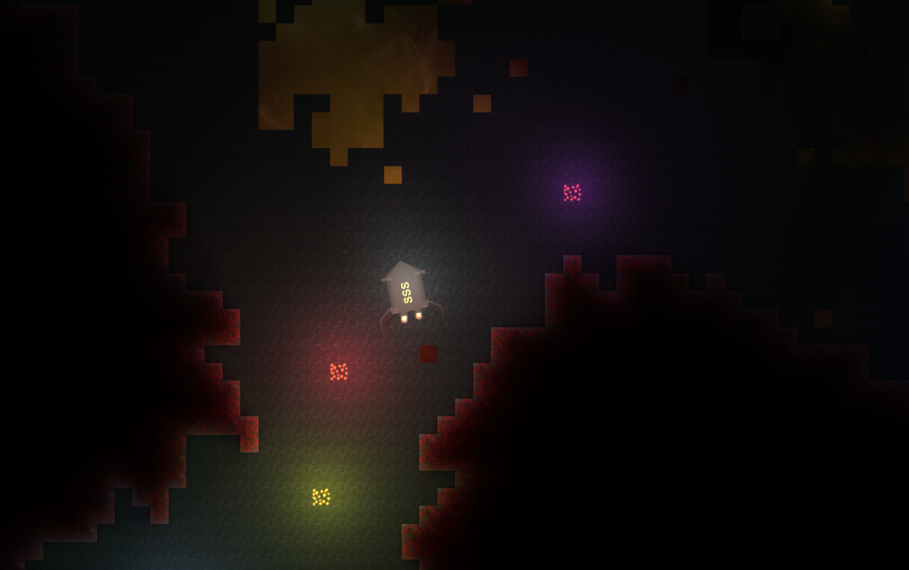

# Light2D

Light2D is a GPU-based dynamic 2D lighting package for Unity with a distinctive
look: colored, per-channel light transmission through obstacles, soft ambient
bounce, and collider-free occlusion authored straight from your sprites, meshes,
and tiles. Lights and obstacles move at runtime, need no physics colliders, and
render on both the Built-in Render Pipeline and URP from a single package.

Light2D targets **Unity 6000.3** (minimum) and is developed on **Unity 6000.5.4f1**.
It supports the Built-in Render Pipeline and URP 17.3; HDRP and other Scriptable
Render Pipelines are not supported.



## Why Light2D

- **Colored per-channel transmission.** Obstacles absorb and tint light per RGB
  channel, so shadows can be colored and materials can filter light — not just
  block it.
- **Soft ambient bounce.** An optional temporal ambient-propagation pass spreads a
  soft fill light through the scene.
- **Zero-authoring, collider-free occlusion.** Obstacles are your existing sprites,
  meshes, or tilemap tiles — no hand-placed shadow-caster shapes, no colliders. The
  Tilemap occluder is even texture-aware, so transparent tile pixels pass light.
- **One package, both pipelines.** The same components drive the Built-in Render
  Pipeline and URP 17.3+.

## When to use Unity's built-in 2D lights instead

Light2D fills a specific niche. For mainstream URP 2D lighting, Unity's own
**2D lights** (URP 2D Renderer) are the better default and are actively maintained
by Unity, with light types, normal maps, and `ShadowCaster2D`-based shadows.

Prefer Unity's built-in 2D lights when you want:

- A Unity-supported, actively maintained solution with documentation and community
  reach.
- Hard-edged shadow casters and standard 2D light types out of the box.
- To stay entirely inside the URP 2D feature set without an extra package.

Prefer **Light2D** when you specifically want its look and constraints: colored
per-channel transmission, soft ambient bounce, collider-free/texture-aware
occlusion from existing art, or Built-in Render Pipeline support (see
[Pipeline Support](#pipeline-support)).

## Documentation

- [Installation and setup](Documentation~/INSTALLATION.md)
- [Components, settings, and render architecture](Documentation~/ARCHITECTURE.md)
- [Frequently asked questions](Documentation~/FAQ.md)
- [Migration and upgrade notes](Documentation~/MIGRATION.md)
- [Troubleshooting](Documentation~/TROUBLESHOOTING.md)
- [Development and testing](Documentation~/TESTING.md)
- [Diagnostics and benchmarking](Documentation~/BENCHMARKING.md)
- [Changelog](CHANGELOG.md)
- [License](LICENSE.md)

## Install

This package lives under `Packages/com.sss13594.light2d/` in the [Light2D repository](https://github.com/SSS135/Light2D). Point Unity at that subpath, not the repository root.

**Git URL:** In **Window > Package Management > Package Manager**, select **Install package from git URL...** and enter:

```text
https://github.com/SSS135/Light2D.git?path=/Packages/com.sss13594.light2d
```

Pin a tag, branch, or commit by appending a revision after the `path` query, for example:

```text
https://github.com/SSS135/Light2D.git?path=/Packages/com.sss13594.light2d#v2.0.0
```

when that tag is available.

**Local disk:** Select **Install package from disk...** and choose the package's `package.json` under `Packages/com.sss13594.light2d/`. A manifest entry for a checkout is:

```json
"com.sss13594.light2d": "file:X:/src/unity/Light2D/Packages/com.sss13594.light2d"
```

Unity installs the package dependencies declared in `package.json`, including URP 17.3 even when the consuming project uses the Built-in Render Pipeline.

Tilemap obstacles (`LightObstacleTilemap`) additionally require the
**`com.unity.2d.tilemap`** package. When it is present the component compiles
automatically (through the `LIGHT2D_TILEMAP` define); without it, the rest of
Light2D is unaffected.

## First Setup

1. Add a `LightingSystem` to the camera that should receive lighting:
   **GameObject > Light2D > Lighting System**. It assigns the overlay, ambient, and
   blur materials automatically.
2. Add a light with **GameObject > Light2D > Light Source** (`LightSprite`).
3. Turn existing sprites, meshes, or tilemaps into obstacles: select them and use
   **GameObject > Light2D > Light Obstacle**. The command adds the right obstacle
   component for the renderer (`LightObstacleSprite`, `LightObstacleMesh`, or, with
   the Tilemap package, `LightObstacleTilemap`).
4. For soft fill light, enable `EnableAmbientLight` on the `LightingSystem` and add
   ambient emitters with **GameObject > Light2D > Ambient Emitter**
   (`LightAmbientEmitter`).

There are no layers to create and no camera culling mask to edit — each component
registers itself and is drawn only into Light2D's textures.

- **URP:** install `Light2DUniversalRendererFeature` on the renderer used by the
  camera (the creation window and the `LightingSystem` inspector offer
  **Install / Repair Renderer Feature**). It supports Universal Renderer Data and
  2D Renderer Data.
- **Built-in:** no extra setup — `LightingSystem` composites through
  `OnRenderImage`.

A newly configured scene can appear black until it contains a light source or an
ambient emitter.

## Samples

Open Package Manager, select **Light2D**, expand **Samples**, and import **Examples**. Unity copies the sample to `Assets/Samples/Light2D/<version>/Examples`. It contains the **Small Examples**, **Rocket**, and **Rocket Tilemap** scenes and their supporting assets.

The sample scenes register their lights, obstacles, and ambient emitters through
the Light2D components automatically. For URP, (re)install the renderer feature on
the renderer used by the sample camera after import.

## Core Concepts

Light2D expresses three lighting roles as self-registering components. There are no
Light2D layers: a GameObject participates in lighting only if it carries a Light2D
component, and each component registers itself when enabled and is drawn directly
into Light2D's internal textures through a command buffer.

- `LightingSystem` belongs on the camera receiving the final composite. It owns
  quality settings, material references, and per-camera rendering state.
- `LightSprite` renders a sprite-shaped point or line light. Ray-marching materials
  trade GPU cost for more obstacle samples; `Light 1 Point` and
  `Light Ignoring Obstacles` are cheaper alternatives.
- `LightObstacleSprite` mirrors a sprite or `CustomSprite`; `LightObstacleMesh`
  mirrors mesh data; `LightObstacleGenerator` adds the right one at runtime; and
  `LightObstacleTilemap` (with `com.unity.2d.tilemap`) makes a Tilemap a
  texture-aware obstacle.
- `LightAmbientEmitter` contributes ambient emission when ambient lighting is
  enabled, replacing the old "any renderer on the ambient layer" convention.
- Obstacle RGB controls transmitted light by channel. Dark values block more light;
  colored obstacles filter channels. Alpha participates in obstacle rendering
  according to the selected material.
- The overlay and ambient materials expose the artistic controls. Runtime code
  clones serialized materials, so per-camera updates do not mutate project assets.

Light texture resolution is derived from camera coverage and `Light Pixel Size`. A smaller value creates more pixels per world unit and costs more GPU time and memory. Start with a displayed texture height of 50-200 on mobile or 200-1000 on desktop, then profile the target device.

## Pipeline Support

| Pipeline | Status |
| --- | --- |
| URP 17.3+ | Supported. RenderGraph renderer feature on Universal Renderer Data or 2D Renderer Data. |
| Built-in Render Pipeline | Supported as a compatibility path. `LightingSystem.OnRenderImage` composites the lighting textures over the camera. |
| HDRP or another SRP | Not supported. `LightingSystem` rejects non-URP SRPs with one warning. |

Built-in Render Pipeline support is a compatibility bonus for existing Built-in
projects. Unity has announced the Built-in Render Pipeline's deprecation, so new
projects should target URP; Light2D's URP backend is the forward-looking path.

Current limitations:

- Normal mapping is orthographic XY-only in both backends, and the inspector warns against mobile use.
- Perspective cameras are supported for basic lighting, but depend on one `Camera To Light Obstacles Distance` plane and do not support normal mapping.
- `Affect Only This Camera` is a Built-in-only composition mode and is incompatible with a source camera target texture. In URP, the feature already runs per camera.
- URP skips preview cameras, reflection cameras, and frames rendering directly to the active back buffer. The feature requests an intermediate color texture.
- Very small obstacles can disappear at low light-texture resolutions. Off-screen lights can clip if the light-camera margin is too small.
- XR rendering and URP camera stacks (Overlay cameras, or Base cameras with an active Overlay stack) are not supported and are skipped safely with one warning per camera. Independent URP Base cameras, including split screen, are supported.

The package ships EditMode suites (contracts, lifecycle and resource release, components, diagnostics, editor workflows, package integrity, shader import, and URP feature/camera policy) plus Built-in and URP PlayMode suites. See [TESTING.md](Documentation~/TESTING.md) for the current verification status of each backend.

## Package Layout

| Path | Purpose |
| --- | --- |
| `Runtime/` | Components, materials, resources, shaders, and the URP renderer feature |
| `Editor/` | Creation tools, inspectors, renderer-feature installer, and migration utility |
| `Samples~/Examples/` | Importable demonstration scenes and assets |
| `Documentation~/` | Package documentation and illustrations |
| `CHANGELOG.md` | Canonical package changelog |
| `Tests/` | EditMode and PlayMode test assemblies |

The package is developed and tested inside the [Light2D repository](https://github.com/SSS135/Light2D), whose root is a Unity 6000.5.4f1 project that embeds this package under `Packages/com.sss13594.light2d/`. That host project, its test automation, and the URP sentinel are not part of the published UPM payload.

The package name is `com.sss13594.light2d`. Runtime types are in the `Light2D` namespace and compile into `Light2D.Runtime`; editor tooling compiles into `Light2D.Editor`.

## Public API Policy

The supported public runtime API is limited to the scene components (`LightingSystem`, `LightSprite`, `CustomSprite`, `LightObstacleSprite`, `LightObstacleMesh`, `LightObstacleGenerator`, `LightAmbientEmitter`, and — when `com.unity.2d.tilemap` is installed — `LightObstacleTilemap`), the `Light2DUniversalRendererFeature`, the diagnostics surface (`Light2DProfiling`, `Light2DDiagnostics`, `Light2DFrameMetrics`), and the `Light2DPipeline` readiness classification exposed through `LightingSystem.ActivePipeline` and `LightingSystem.IsRenderingReady`. Serialized field names on these components are compatibility contracts and are preserved across releases. Everything else is internal implementation and may change without notice; a contract test enforces the exported type list. The legacy `Util` and `Point2` helpers were removed in 2.0.0.

## License

Light2D is available under the [MIT License](LICENSE.md).
