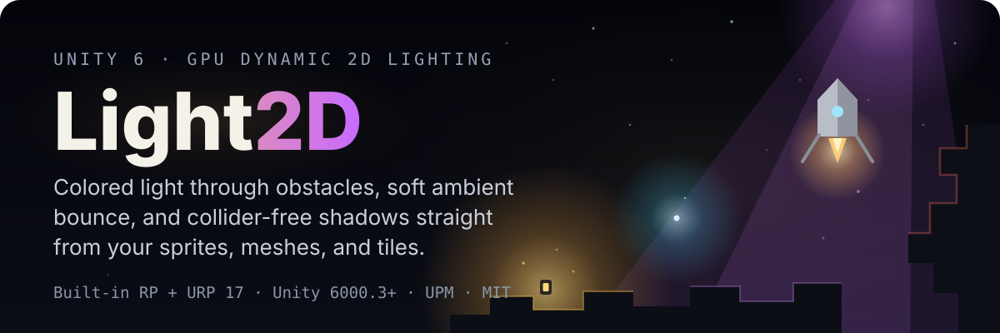
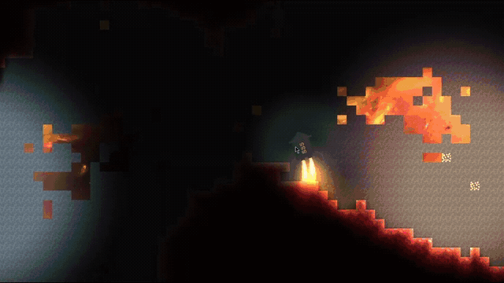
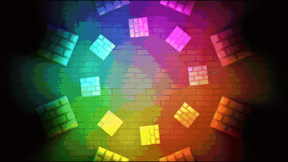
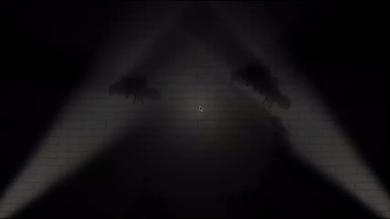
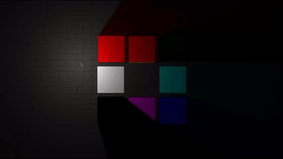
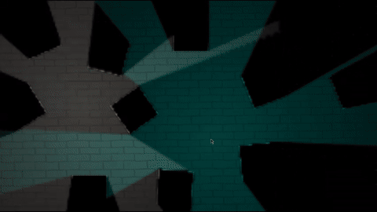
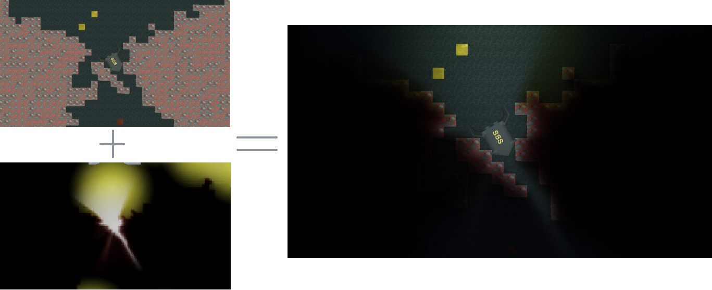
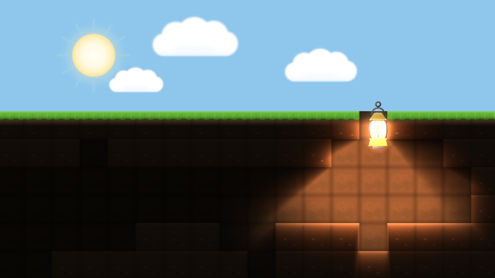

<p align="center">
  
</p>

<p align="center">
  
</p>

<p align="center"><i>The <b>Rocket</b> sample, recorded live in-engine: a lander threads a dark cave while its thruster flame and glowing red, purple, and green crystals light the terrain and cast moving shadows in real time.</i></p>

Light2D is a GPU-based dynamic 2D lighting package for Unity with a distinctive look: colored per-channel light transmission through obstacles, soft ambient bounce, and collider-free occlusion authored straight from your sprites, meshes, and tiles. Lights and obstacles move freely at runtime and need no physics colliders. One package drives both the Built-in Render Pipeline and URP 17.3+ on Unity 6000.3 or newer, under the MIT license.

## Showcase

All of these are live in-engine recordings from the bundled <b>Examples</b> sample:

<table>
<tr>
<td width="50%">

<br/>
<sub>Colored point lights wash floating sprite obstacles, and each block casts its own colored shadow.</sub>
</td>
<td width="50%">

<br/>
<sub>Bat-shaped occluders fly across a white light, sweeping large soft shadows over the wall.</sub>
</td>
</tr>
<tr>
<td width="50%">

<br/>
<sub>A point light cycles through hues, tinting a cluster of block obstacles and the shadows they cast.</sub>
</td>
<td width="50%">

<br/>
<sub>A single white light sweeps drifting cube obstacles, each catching the light and casting a soft shadow.</sub>
</td>
</tr>
</table>

## Why Light2D

- **Colored per-channel transmission.** Obstacles absorb and tint light per RGB channel, so shadows can be colored and materials can filter light instead of just blocking it.
- **Soft ambient bounce.** An optional temporal ambient-propagation pass spreads a soft fill light through open space.
- **Collider-free, texture-aware occlusion.** Your existing sprites, meshes, and tilemap tiles act as obstacles, without hand-placed shadow casters or colliders. Transparent tile pixels pass light.
- **Scoped lighting with coverage volumes.** Drop a `Light2DVolume` to confine lighting to caves or interiors, the classic "bright overworld, dark cave" look.
- **One package, both pipelines.** The same components render on the Built-in Render Pipeline and on URP's Universal and 2D Renderers.

Unity's own 2D lights cover mainstream URP lighting well. Light2D is for a different look: colored transmission, ambient bounce, and occlusion taken straight from your existing art. It is also the option that runs on the Built-in Render Pipeline. The [package README](Packages/com.sss13594.light2d/README.md#when-to-use-unitys-built-in-2d-lights-instead) compares the two in detail.

## How it works



Every Light2D component registers itself when enabled and is drawn through a command buffer into low-resolution light-input textures: obstacles, direct lights, then optional ambient propagation. The result is composited over the camera image, via `OnRenderImage` on the Built-in pipeline and via a URP 17 RenderGraph renderer feature on URP. You never set up lighting layers, helper cameras, or culling masks. Details live in [ARCHITECTURE.md](Packages/com.sss13594.light2d/Documentation~/ARCHITECTURE.md).

## Install

In **Window > Package Management > Package Manager**, choose **Install package from git URL...** and enter:

```text
https://github.com/SSS135/Light2D.git?path=/Packages/com.sss13594.light2d
```

Point Unity at that subpath, not the repository root; the root is the development project. Pin a tag, branch, or commit by appending `#<revision>` after the `path` query. Tilemap obstacles also need the `com.unity.2d.tilemap` package; everything else works without it. Local-disk and embedded installs are covered in [INSTALLATION.md](Packages/com.sss13594.light2d/Documentation~/INSTALLATION.md).

## First scene

1. Add a `LightingSystem` to your camera: **GameObject > Light2D > Lighting System**.
2. Add a light: **GameObject > Light2D > Light Source**.
3. Select existing sprites, meshes, or tilemaps and run **GameObject > Light2D > Light Obstacle**. The command picks the right obstacle component for the renderer.
4. **URP only:** install `Light2DUniversalRendererFeature` on the camera's renderer (the `LightingSystem` inspector offers **Install / Repair Renderer Feature**). Built-in needs no extra setup.

A freshly configured scene can look black until it contains a light source or an ambient emitter. That black screen is the lighting working.

## The components

| Component | Role |
| --- | --- |
| `LightingSystem` | On the camera; owns quality settings and the final composite |
| `LightSprite` | Sprite-shaped point, spot, or line light |
| `LightObstacleSprite` | Mirrors a `SpriteRenderer` as an occluder |
| `LightObstacleMesh` | Mirrors a `MeshRenderer`'s mesh and texture as an occluder |
| `LightObstacleTilemap` | Texture-aware `Tilemap` occluder (with `com.unity.2d.tilemap`) |
| `LightObstacleGenerator` | Adds the right obstacle component at runtime |
| `LightAmbientEmitter` | Feeds the ambient-propagation pass |
| `Light2DVolume` | Scopes how much Light2D applies inside a region |

## Pipeline support

| Pipeline | Status |
| --- | --- |
| URP 17.3+ | Supported: RenderGraph renderer feature on Universal Renderer Data or 2D Renderer Data |
| Built-in Render Pipeline | Supported as a compatibility path via `OnRenderImage` |
| HDRP / other SRPs | Not supported; rejected with a single warning |

Unity has announced Built-in's deprecation, so new projects should target URP. Current limitations (normal mapping, perspective cameras, XR, camera stacks) are listed in the [package README](Packages/com.sss13594.light2d/README.md#pipeline-support).

## Samples

<p align="center">
  
</p>

Import **Examples** from the package's Samples list in Package Manager:

- **Small Examples** cycles through direct lights, sprite and mesh obstacles, ambient emitters, and normal mapping.
- **Rocket** is a playable lander in a colored-light cave with generated obstacle meshes (the hero clip above).
- **Rocket Tilemap** rebuilds the same cave from a `Tilemap` with the texture-aware obstacle.
- **Light Volume** is the "bright overworld, dark cave" coverage-volume demo (pictured above): the `Light2DVolume` keeps the lighting inside the cave while the overworld shows its raw art.

## This repository

The repository root is the Unity 6000.5.4f1 project used to develop and test the package. Open the **root** in Unity, not a subfolder.

| Path | Purpose |
| --- | --- |
| [`Packages/com.sss13594.light2d/`](Packages/com.sss13594.light2d/) | The UPM package: runtime, editor, tests, samples, docs |
| `Assets/` | Development-host scenes, sample install, and test automation |
| `ProjectSettings/`, `Packages/manifest.json` | Unity project configuration for the host |

## Documentation

- [Package README](Packages/com.sss13594.light2d/README.md)
- [Installation and setup](Packages/com.sss13594.light2d/Documentation~/INSTALLATION.md)
- [Components, settings, and render architecture](Packages/com.sss13594.light2d/Documentation~/ARCHITECTURE.md)
- [Frequently asked questions](Packages/com.sss13594.light2d/Documentation~/FAQ.md)
- [Migration and upgrade notes](Packages/com.sss13594.light2d/Documentation~/MIGRATION.md)
- [Troubleshooting](Packages/com.sss13594.light2d/Documentation~/TROUBLESHOOTING.md)
- [Runtime diagnostics](Packages/com.sss13594.light2d/Documentation~/BENCHMARKING.md)
- [Development and testing](docs/TESTING.md)
- [Benchmarking protocol](docs/BENCHMARKING.md)
- [Changelog](Packages/com.sss13594.light2d/CHANGELOG.md)

## License

Light2D is available under the [MIT License](LICENSE.md). It began in 2017 as one of the early open-source 2D lighting assets for Unity; the original project was archived in 2018 and has been rebuilt for Unity 6 as 2.0 with a register-and-draw architecture. The package is maintained by the community and is not affiliated with Unity.
